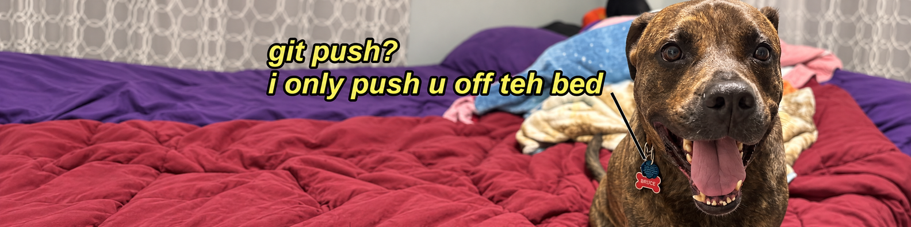

I started in technology sales at AT&amp;T, helping people figure out what tech they actually needed. 
Now I'm learning to build it: studying AWS, taking AI coursework at ODU, and building small projects here. 
My creative side is <b>MONKED</b> (in development), an experimental space for AI and interactive web ideas.
<!-- MONKED link: https://monked.si (restore at launch) -->

  <a href="https://www.linkedin.com/in/julian-monk-45635b356/"><b>LinkedIn</b></a> ·
  <a href="https://github.com/jmonked"><b>GitHub</b></a> ·
  <b>MONKED</b> (in development)
  <!-- MONKED link: <a href="https://monked.si"><b>MONKED</b></a> (restore at launch) -->

<picture><source media="(prefers-color-scheme: dark)" srcset="./assets/terminal_dark.svg"/><source media="(prefers-color-scheme: light)" srcset="./assets/terminal_light.svg"/></picture>

  
  
  
  

## 🎓 Learning path

| What | Status |
|:--|:--|
| Undergraduate Certificate in AI, Old Dominion University (6 courses) | 🎓 In progress: 1 of 6 done, expected Spring 2027 (not earned yet) |
| ↳ AI 410/510: AI Methods and Models | ✅ Completed Oct 2026, A (98%) |
| ↳ AI 446: AI Ethics and Policy | 📖 In progress |
| AWS Cloud Practitioner Essentials (Skill Builder) | 🧭 Not started (planned next) |
| AWS Certified Cloud Practitioner (CLF-C02) | 📖 Studying for the exam |
| AWS Certified AI Practitioner (AIF-C01) | 🧭 Planned |

<em>No AWS certifications earned yet. This table updates when that changes.</em>

## 🧰 Projects

<table>
<tr><td width="100%" valign="top">
<b>1. AWS Cost Watchdog</b>

Python-based cost-monitoring prototype. Implemented and tested locally with synthetic billing data. Not connected to or deployed on a live AWS account.

 

</td></tr>
<tr><td width="100%" valign="top">
<b>2. Cloud Resume Challenge</b>

AWS infrastructure and visitor-counter foundation. Implemented and tested locally; AWS deployment and live browser integration are pending.

 

</td></tr>
<tr><td width="100%" valign="top">
<b>3. AI Study-Notes Quizzer</b>

Offline, rule-based study tool. Imports Markdown notes, builds source-linked term-recall questions, and tracks progress locally. Working local MVP; not AI-powered and not deployed.

</td></tr>
<tr><td width="100%" valign="top">
<b>4. MONKED</b> (in development)
<!-- MONKED link: https://monked.si (restore at launch) -->

Experimental personal website and creative technology project. In active development.

</td></tr>
</table>

<em>Local prototypes run offline only. Nothing here is deployed on live AWS yet.</em>

## 📂 More

<b>💼 Where I'm coming from</b>

 

- **AT&amp;T, Retail Sales Consultant** (Apr 2025 – Sep 2026): 115% of overall sales quota, 400+ phone upgrades, 140+ postpaid line activations; used Salesforce and Opus daily
- **Dillard's, Sales Associate** (Oct 2024 – Jan 2025): customer consultations and product recommendations
- **Albertsons Starbucks, Manager** (Mar – Jul 2024): led and coached a team of 8 baristas

<b>📚 What I'm learning</b>

 

- **AWS:** core services, security, pricing, and Well-Architected basics (Skill Builder)
- **Python:** learning, early days
- **SQL:** learning, early days
- **AI/ML:** ODU AI certificate coursework, plus building with AI tools and learning where they fit in cloud workflows

<b>🛠️ Tools I use</b>

 

  
  
  
  
  
  

<b>🤝 Why sales → cloud</b>

 

> Sales taught me to listen for the problem behind the request. Cloud and AI are how those problems get solved, and I want to be able to build the solution, not just recommend it.

<b>🎮 Off the clock — Defiy &amp; creator socials</b>

 

Gaming, clips, and MONKED/Defiy stuff (OSRS humor included):

<a href="https://x.com/idefiy">X</a> · <a href="https://www.youtube.com/@idefiyy">YouTube</a> · <a href="https://www.twitch.tv/idefiyy">Twitch</a> · <a href="https://www.tiktok.com/@jmonked">TikTok</a> · <a href="https://www.instagram.com/monkedd_">Instagram</a> · <a href="https://www.reddit.com/user/iDefiy">Reddit</a>

