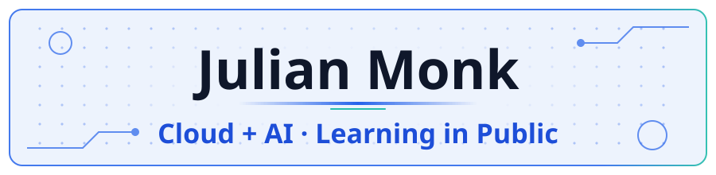

<!-- BRAND: banner/logo goes here (should match avatar, monked.si logo, and favicon) -->
<!-- COLOR VARIANT A (refined): electric blue primary, teal sparingly. Provisional, not final brand. -->

<picture><source media="(prefers-color-scheme: dark)" srcset="./assets/banner_dark.svg"/><source media="(prefers-color-scheme: light)" srcset="./assets/banner_light.svg"/></picture>

<b>Tech sales → cloud + AI, learning in public</b>

I've spent about two years in sales, most recently in technology sales, learning how people choose and use tech. 
Now I'm learning to build it: studying AWS, working with AI tools, and sharing my progress here. 
My creative side is <b>MONKED</b>, a personal space for experimenting with AI and interactive web ideas (<b>monked.si</b>, coming soon).

<!-- BRAND: accent color for links/badges goes here (currently GitHub default) -->

  <a href="https://www.linkedin.com/in/julian-monk-45635b356/">LinkedIn</a> ·
  <a href="https://x.com/idefiy">X</a> ·
  <a href="https://www.youtube.com/@idefiyy">YouTube</a> ·
  <a href="https://www.twitch.tv/idefiyy">Twitch</a> ·
  <a href="https://www.tiktok.com/@jmonked">TikTok</a> ·
  <a href="https://www.instagram.com/monkedd_/">Instagram</a>

<picture><source media="(prefers-color-scheme: dark)" srcset="./assets/terminal_dark.svg"/><source media="(prefers-color-scheme: light)" srcset="./assets/terminal_light.svg"/></picture>

  
  
  

## ☁️ Cert path

| Certification | Status |
|:--|:--|
| AWS Certified Cloud Practitioner (CLF-C02) | 📖  |
| AWS Certified AI Practitioner (AIF-C01) | 🧭  |
| Undergraduate Certificate in Artificial Intelligence, ODU (university) | 🎓 In progress, exp. 2027 |
| More AWS certifications | 🗺️ Goal: several in ~1 year |

## 🧰 Projects

**🛠️ In progress**

<table>
<tr>
<td width="100%" valign="top">
<b>MONKED</b> 
My personal creative space for experimenting with AI, technology, and interactive web experiences. Currently exploring its design and direction. 
Status: 🧪 
</td>
</tr>
</table>

**🧭 Planned**

<table>
<tr>
<td width="100%" valign="top">
<b>aws-cloud-practitioner-notes</b> 
CLF-C02 study notes and cheat sheets, written in public. 
<code>Markdown</code> <code>AWS</code>
</td>
</tr>
<tr>
<td width="100%" valign="top">
<b>s3-cloudfront-static-site</b> 
Beginner AWS project: a static site on S3 + CloudFront with HTTPS, documented step by step. 
<code>S3</code> <code>CloudFront</code> <code>ACM</code>
</td>
</tr>
<tr>
<td width="100%" valign="top">
<b>ai-tools</b> 
Small scripts and AI workflows built while learning Python. 
<code>Python (learning)</code> <code>AI APIs</code>
</td>
</tr>
</table>

## 📂 More

<b>📚 What I'm learning</b>

 

- **AWS:** core services, security, pricing, and Well-Architected basics
- **Python:** learning, early days
- **SQL:** learning, early days
- **AI (school):** Undergraduate Certificate in Artificial Intelligence, Old Dominion University School of Data Science (in progress, expected Spring 2027)
- **AI:** building with AI tools and learning where they fit in cloud workflows

<b>🛠️ Tools I use</b>

 

  
  
  
  
  
  

<b>🤝 Why sales → cloud</b>

 

> Sales taught me to listen for the problem behind the request. Cloud and AI are how those problems get solved, and I want to be able to build the solution, not just recommend it.

<!-- BRAND: footer divider/accent goes here -->

